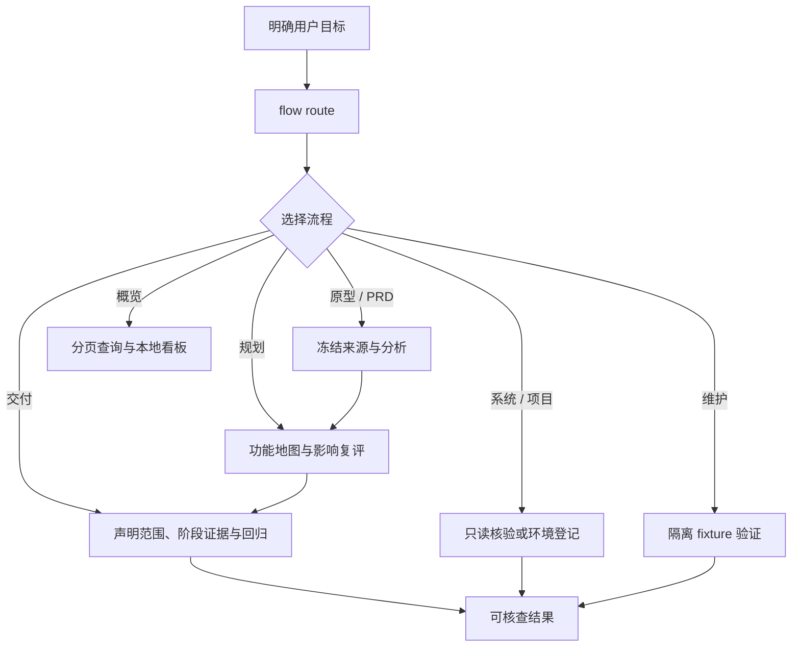
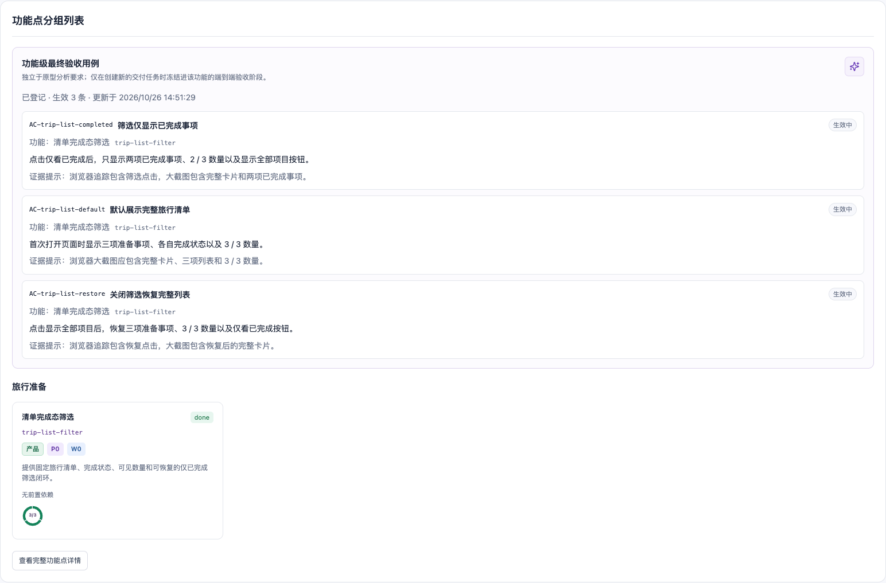
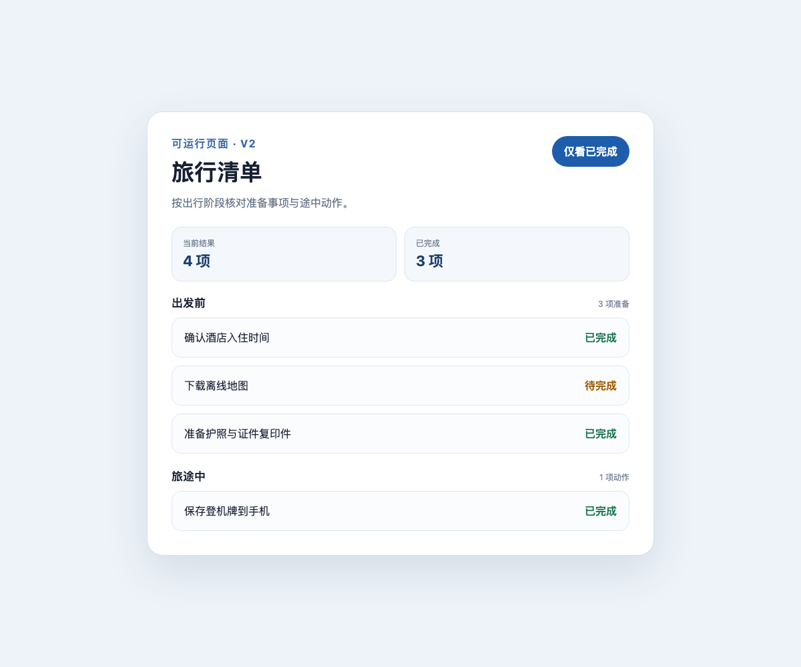

# mf-dev-flow

`mf-dev-flow` 是面向 Codex 项目的本地开发流程技能：它把原型取证、PRD 阅读、功能规划、交付验收、外部系统核验和项目登记分成显式流程，并为每一步保留可核查的输入、状态与证据边界。

它不是通用的项目管理 SaaS，也不会上传项目数据。业务状态始终保存在消费项目自己的 `.mf-dev-flow/` 目录中；本仓库提供技能、CLI、Codex hook 和只读本地看板。

## 能力

- 按当前意图路由到原型、PRD、规划、交付、系统、项目、概览或维护流程。
- 在原型与 PRD 流程中冻结来源、记录问题/需求和验证状态，而不把推断当作事实。
- 以显式写入范围、基线快照和阶段门禁协调交付任务；未归因的改动保持可见，不自动归属。
- 提供可重建的功能依赖图、版本化任务类型与能力登记表。
- 提供只监听 `127.0.0.1` 的 Next.js 看板，用于阅读本地状态与证据；HTTP 接口只读。
- 对 Codex 生命周期提供 fail-open 的观测与门禁适配；hook 故障会记录为 degraded，而不会静默伪称通过。

## 工作方式



流程只在明确授权的范围内写入。尤其是 `maintenance` 仅维护本技能及隔离 fixture，不读取、扫描或迁移消费者项目真实的 `.mf-dev-flow/` 状态。

## 前置条件

- Node.js 22.18 或更高版本（原型索引要求此版本）；看板本身要求 Node.js 20.11 或更高版本。
- 如需运行看板，安装 [pnpm](https://pnpm.io/)。
- 使用支持项目级技能与 hooks 的 Codex 环境。

## 安装到一个 Codex 项目

先将本仓库克隆到任意稳定位置，再把它作为消费项目中的技能入口。下面使用软链接，便于独立更新技能；也可以复制目录。

```bash
git clone <repository-url> /path/to/mf-dev-flow
cd /path/to/mf-dev-flow
npm --prefix modules/prototype ci
cd /path/to/your-project
mkdir -p .codex/skills
ln -s /path/to/mf-dev-flow .codex/skills/mf-dev-flow
```

若启用 hook，请在消费项目的 Codex 设置中审核并信任该项目的 `.codex/hooks.json`。不要把 hook 配置或软链接的信任状态当作已通过业务验收的证据。

## 快速开始

在消费项目根目录执行。`flow route` 只确定入口；未确定流程时不会扫描、建运行或领取任务。

```bash
D=.codex/skills/mf-dev-flow/scripts/mf-dev-flow.mjs

# 查看可用流程与入口
node "$D" flow list --json

# 为当前会话显式选择流程
node "$D" flow route --session <session-id> --flow prototype

# 查看技能版本和本地协调状态
node "$D" version --json
node "$D" coordination status --json
```

各流程的第一条命令、可写位置和完成条件由 [`modules/workflow/registry.json`](modules/workflow/registry.json) 统一登记。只在选定流程的入口文档及其链接协议中继续阅读，避免将全部历史和数据加载进上下文。

## 五分钟看懂一次闭环

不必先接入真实项目。仓库附带一个可公开、可运行的旅行清单项目。它从 PRD 与原型基线开始，先交付简单筛选，再通过 PRD v2 演进为“阶段分组 → 跨分组筛选 → 当前结果摘要”三个功能。

```bash
git clone <repository-url> mf-dev-flow
cd mf-dev-flow/examples/travel-checklist-evolution

# 首次运行时安装原型解析器和看板依赖；之后可跳过。
npm --prefix ../../modules/prototype ci
pnpm --dir ../../dashboard install

# 选择五分钟最小闭环里程碑；看板只读，不改写状态。
node scripts/select-case.mjs case-03
node ../../scripts/mf-dev-flow.mjs dashboard
```

浏览器打开 <http://127.0.0.1:4173/>，依次看“功能点分组列表”和“运行历史”，再打开示例页面实际操作筛选。



完整示例按五个 Case 编排，每个 Case 都有场景、操作、大截图和效果说明；最终看板保留旧 AC 被替代、三个功能依赖和全部交付证据。



入口见 [`examples/travel-checklist-evolution/README.md`](examples/travel-checklist-evolution/README.md)，五分钟说明见 [`docs/five-minute-demo.md`](docs/five-minute-demo.md)。示例里程碑是在中性工作区实际执行 `mf-dev-flow` 后冻结的状态，不是手工拼装的演示 JSON。

## 本地看板

看板读取消费项目的 `.mf-dev-flow/` 数据并只监听本机回环地址。

```bash
npm --prefix .codex/skills/mf-dev-flow/modules/prototype ci
pnpm --dir .codex/skills/mf-dev-flow/dashboard install
node .codex/skills/mf-dev-flow/scripts/mf-dev-flow.mjs dashboard
```

默认访问地址为 <http://127.0.0.1:4173/>。更多页面行为、生产启动方式和浏览器测试说明见 [`dashboard/README.md`](dashboard/README.md)。

## 目录结构

```text
SKILL.md                    # 供 Codex 读取的最短入口说明
flows/                      # 各流程协议与维护记录
modules/                    # CLI 领域模块、登记表和纯函数
scripts/                    # 公共 CLI 兼容入口及隔离测试
integrations/codex/hooks/   # Codex 生命周期适配与策略引擎
dashboard/                  # 只读本地 Next.js 看板
agents/openai.yaml          # 技能展示元数据
```

## 验证

所有维护测试都应在临时 fixture 中运行，不能借测试读取或修改真实项目状态。

```bash
# 核心 CLI 与模块回归
node --test scripts/*.test.mjs modules/*/tests/*.test.mjs

# Codex hook 回归
node --test integrations/codex/hooks/mf-dev-flow.test.mjs

# Dashboard 单测、类型检查和生产构建
pnpm --dir dashboard test
pnpm --dir dashboard exec tsc --noEmit --incremental false
pnpm --dir dashboard build
```

可选的浏览器 smoke/E2E 测试需要 Chromium：

```bash
pnpm --dir dashboard exec playwright install chromium
pnpm --dir dashboard test:smoke
pnpm --dir dashboard test:e2e
```

## 数据与安全边界

- 不提交真实 `.mf-dev-flow/` 状态、原型截图、冻结来源、运行记录、环境文件或凭据。
- 不把 `NEXT_PUBLIC_*` 或任何浏览器可见配置当作秘密；看板不需要 API 密钥。
- 看板仅适合本机观察。若要暴露到网络，必须自行部署生产构建、访问控制和反向代理。
- 文档与测试中的项目名、路径和 URL 应使用中性示例，不记录本机用户名、客户名或内部仓库位置。

详细维护边界见 [`flows/maintenance/entry.md`](flows/maintenance/entry.md)，Codex hook 约定见 [`integrations/README.md`](integrations/README.md)。

## 贡献与安全报告

提交前请阅读 [`CONTRIBUTING.md`](CONTRIBUTING.md)。安全问题请遵循 [`SECURITY.md`](SECURITY.md)，不要在公开 issue 中披露可利用细节或凭据。

## 许可证

本项目采用 [MIT License](LICENSE)。
