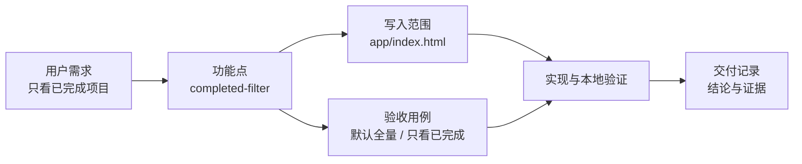
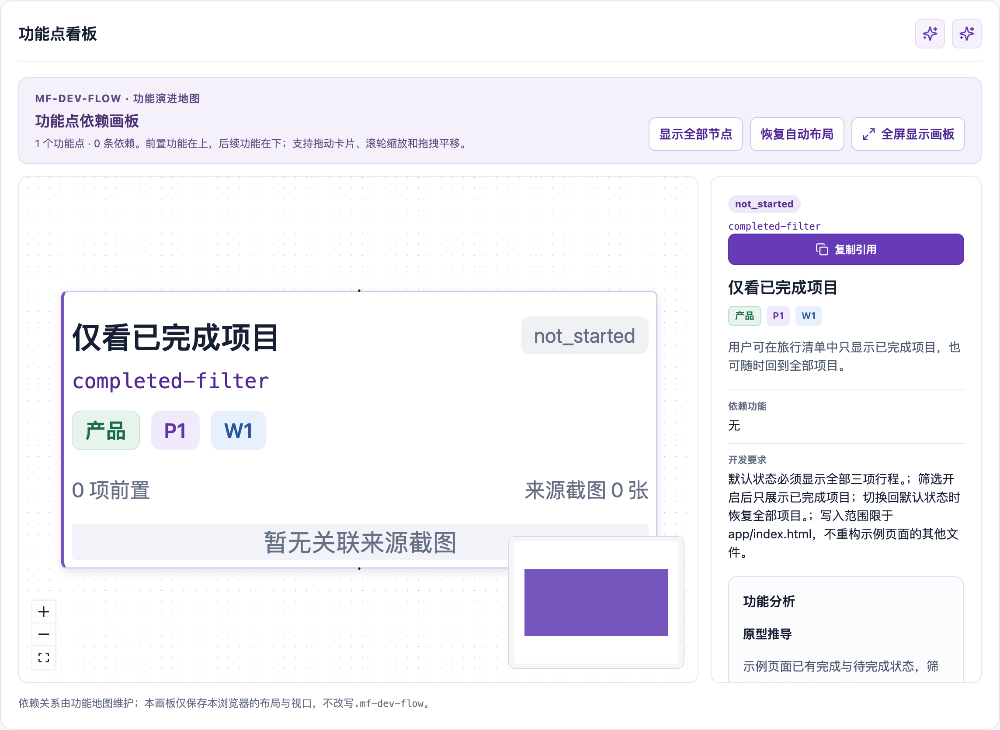

# 五分钟最小闭环：旅行清单筛选

这是一条可以在小功能中看清价值的完整链路，而不是对所有命令的演示。所有名称、需求和状态均为合成示例；它们可以安全地随仓库公开。

## 场景

已有一个旅行清单页面。用户提出：

> 我只想看已经完成的行程，方便核对准备情况。

若直接把这句话交给编码代理，容易漏掉默认状态、空结果、可访问性和回归范围。示例将它收束为一个独立可交付的叶子功能：`completed-filter`。



## 用示例查看结果（约 2 分钟）

从仓库根目录运行：

```bash
cd examples/five-minute-cycle
pnpm --dir ../../dashboard install
node ../../scripts/mf-dev-flow.mjs dashboard
```

访问 <http://127.0.0.1:4173/>。示例状态是只读的：看板不会修改 `.mf-dev-flow/` 中的任何内容。

1. 在“功能点看板”找到“仅看已完成项目”。它显示目标、优先级、实现边界和当前阶段。
2. 在“功能点分组列表”打开该功能，查看来源、需求、阶段和最终验收用例。
3. 打开 [`examples/five-minute-cycle/app/index.html`](../examples/five-minute-cycle/app/index.html)，点击“仅看已完成”体验目标交互。



## 从需求到交付（约 3 分钟）

当这个场景出现在你的项目中，最小实践并不要求一次用完所有流程。只做以下四件事即可：

1. **固定结果**：功能点写成“用户可以仅看已完成项目”，而不是“加一个按钮”。
2. **限制写入范围**：本例只允许改 `app/index.html`，避免代理顺手重构无关文件。
3. **先写验收**：默认仍显示全部项目；开启筛选后只显示已完成项目，且空结果可理解。
4. **留下验证结论**：记录实际执行的检查和截图/浏览器证据；未完成的证据保持待补充，不能伪称通过。

其中第 2 和第 3 步是这个工具在小需求上的实际价值：让开发任务具有可验证的边界，而不是只留下自然语言聊天记录。

## 何时值得使用

| 使用场景 | 建议 |
| --- | --- |
| 一个需求会交给多名代理或需要跨轮次续做 | 使用：范围、阶段和证据能减少上下文丢失。 |
| UI 原型、PRD 和实现必须能相互追溯 | 使用：先冻结来源，再做规划和交付。 |
| 只有一次小改动，且同一人从头做到尾 | 按需使用：记录功能点和验收即可，无需展开完整流程。 |
| 临时试验或一次性脚本 | 不建议：流程成本通常高于收益。 |

## 迁移到自己的项目

示例的 `.mf-dev-flow/` 是公开的合成快照，不能复制到生产项目。实际接入时，从项目基线开始：

```bash
# 在你的项目根目录；D 指向已安装的技能目录。
D=.codex/skills/mf-dev-flow/scripts/mf-dev-flow.mjs
node "$D" init \
  --name "你的项目" \
  --background "本轮要解决的用户问题" \
  --prototype-kind html \
  --prototype-location "相对原型路径或公开 URL" \
  --code-root .

# 明确选择入口，再按该入口文档继续。
node "$D" flow route --session <session-id> --flow planning
```

之后由相应流程创建真实状态。不要提交真实 `.mf-dev-flow/`、截图、原型来源、运行日志或凭据；这些只应保留在消费项目本地。
