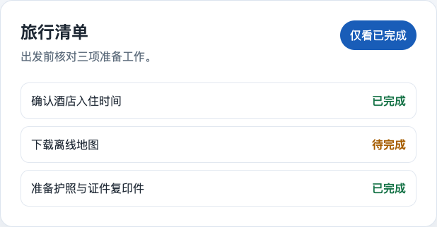
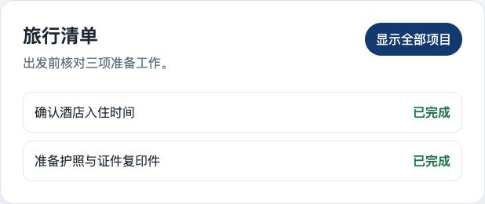

# 功能、验收 Case 与页面截图

本文件只整理一个独立叶子功能，便于在实际项目中按相同结构扩展。截图来自 [`app/index.html`](app/index.html) 的真实浏览器运行；功能地图仍保持 `not_started`，因此这些图片是 case 的页面对照材料，不是伪造的交付通过记录。

## completed-filter · 仅看已完成项目

- **用户结果**：旅行者可聚焦已完成项目，并可恢复查看全部项目。
- **允许写入**：`app/index.html`。
- **不在范围**：持久化、排序、远程同步与账户体系。

| Case | 页面区域 | 操作与预期 | 截图 |
| --- | --- | --- | --- |
| `AC-TRIP-001` 默认显示全部项目 | 标题区、筛选按钮、旅行清单列表 | 初次打开页面；显示三项行程，其中两项已完成、一项待完成；按钮文案为“仅看已完成”。 | [默认态](screenshots/trip-list-default.png) |
| `AC-TRIP-002` 筛选只展示已完成项目 | 筛选按钮、旅行清单列表 | 点击“仅看已完成”；待完成项从列表消失，仅显示两项已完成行程；按钮切换为“显示全部项目”。 | [筛选态](screenshots/trip-list-completed.png) |

### AC-TRIP-001：默认态

验证动作：首次打开页面，不进行任何点击。观察三条列表项和“仅看已完成”按钮。

### AC-TRIP-002：筛选态

验证动作：点击“仅看已完成”。观察“下载离线地图”不再显示，保留两项已完成行程；再点击“显示全部项目”应恢复三条行程。

## 复用规则

新增功能时，每条最终验收 case 至少要记录：对应页面/状态、用户操作、可观察结果和证据位置。一个截图可辅助多个 case，但不要用同一张截图替代不同交互状态的验证。
