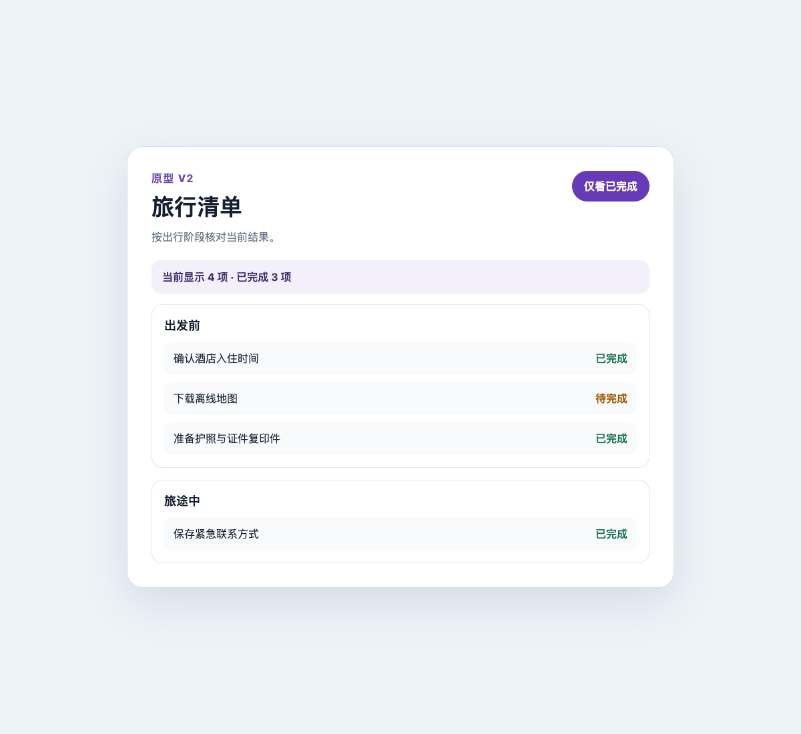

# 原型分析报告

来源：/private/tmp/mf-dev-flow-travel-demo/prototype/v2.html

报告格式：v2；快照：dbc98e18-5422-49b9-9d26-e776e6d0ea2a；范围：full；索引版本：4

可观察边界：本地旅行清单 v2 合成原型；核验阶段分组、筛选、当前结果摘要及恢复路径。

结论：相对固定来源的结构与证据对账通过；仍需人工复核追踪真实性与业务语义。

## 覆盖与未覆盖

| 类型 | 登记 | 完成 | 待办 | 阻塞 | 已撤回计划 |
| --- | ---: | ---: | ---: | ---: | ---: |
| file | 4 | 4 | 0 | 0 | 0 |
| candidate | 21 | 21 | 0 | 0 | 0 |
| node | 2 | 2 | 0 | 0 | 0 |
| edge | 2 | 2 | 0 | 0 | 0 |
| space | 1 | 1 | 0 | 0 | 0 |
| vector | 2 | 2 | 0 | 0 | 0 |
| control | 1 | 0 | 1 | 0 | 0 |
| occurrence | 2 | 2 | 0 | 0 | 0 |
| sweep | 2 | 2 | 0 | 0 | 0 |
| entry | 2 | 2 | 0 | 0 | 0 |
| group | 1 | 0 | 1 | 0 | 0 |
| question | 0 | 0 | 0 | 0 | 0 |
| evidence | 3 | 0 | 3 | 0 | 0 |

截图数量不等于交互覆盖；相同控件在不同前置状态、输入类别与结果分支分别对账。

## 用户流程、页面与状态

### 旅行清单分组与筛选

分组 ID：trip-groups

分组用途：按出行阶段查看事项，并在筛选变化时同步当前结果摘要。

#### 1. 旅行清单 v2 · 全部分组

节点 ID：trip-groups-default；分组：trip-groups；状态：covered

用途：显示两个分组、四项事项和当前显示 4 项、已完成 3 项。

前置与复现：重新打开 prototype/v2.html。

状态取值：{"filter":"all"}

| 截图 | 操作与结果 | 证据 |
| --- | --- | --- |
|  | 操作：打开旅行清单原型 v2，核对默认分组和摘要。；结果：页面显示出发前和旅途中两个分组、四项事项，以及当前显示 4 项、已完成 3 项。 | evidence-0cb0d1da87edad5aff18ad71 · [查看追踪](analyses/travel-prototype-v2/traces/75501e8fe111b4a535defd38cd734c65afde00850a0a85dac90d37fed48acd0a.trace) |
|  | 操作：从仅看已完成状态点击显示全部项目，核对分组、四项事项和默认摘要恢复。；结果：恢复两个分组、四项事项，以及当前显示 4 项、已完成 3 项。 | evidence-cc0b4d999d30b1d81bd06ab0 · [查看追踪](analyses/travel-prototype-v2/traces/75501e8fe111b4a535defd38cd734c65afde00850a0a85dac90d37fed48acd0a.trace) |
|  | show-completed-v2：click #filter，输入类别 none → trip-groups-completed；结果 completed-only：各分组隐藏待完成事项，可见数从 4 变 3，完成数保持 3，按钮变为显示全部项目。；covered；复现：点击仅看已完成，核对分组内筛选和当前结果摘要。；实际结果：两个分组保留，合计只显示三项已完成事项，摘要为当前显示 3 项、已完成 3 项。 | evidence-c44c6ba8d9e0564ac05dc5d2 · [查看追踪](analyses/travel-prototype-v2/traces/75501e8fe111b4a535defd38cd734c65afde00850a0a85dac90d37fed48acd0a.trace) |

#### 2. 旅行清单 v2 · 分组内仅已完成

节点 ID：trip-groups-completed；分组：trip-groups；状态：covered

用途：两个分组合计显示三项已完成事项，摘要同步为当前显示 3 项、已完成 3 项。

前置与复现：从默认状态点击仅看已完成。

状态取值：{"filter":"completed"}

| 截图 | 操作与结果 | 证据 |
| --- | --- | --- |
|  | 操作：点击仅看已完成，核对分组内筛选和当前结果摘要。；结果：两个分组保留，合计只显示三项已完成事项，摘要为当前显示 3 项、已完成 3 项。 | evidence-c44c6ba8d9e0564ac05dc5d2 · [查看追踪](analyses/travel-prototype-v2/traces/75501e8fe111b4a535defd38cd734c65afde00850a0a85dac90d37fed48acd0a.trace) |
|  | restore-all-v2：click #filter，输入类别 none → trip-groups-default；结果 all-items：恢复两个分组、四项事项和默认摘要，按钮变为仅看已完成。；covered；复现：从仅看已完成状态点击显示全部项目，核对分组、四项事项和默认摘要恢复。；实际结果：恢复两个分组、四项事项，以及当前显示 4 项、已完成 3 项。 | evidence-cc0b4d999d30b1d81bd06ab0 · [查看追踪](analyses/travel-prototype-v2/traces/75501e8fe111b4a535defd38cd734c65afde00850a0a85dac90d37fed48acd0a.trace) |

## 截图与证据索引

| ID | 时间 | 动作 | 实际结果 | 截图 | 追踪 |
| --- | --- | --- | --- | --- | --- |
| evidence-0cb0d1da87edad5aff18ad71 | 2026-10-26T07:28:34.000Z | 打开旅行清单原型 v2，核对默认分组和摘要。 | 页面显示出发前和旅途中两个分组、四项事项，以及当前显示 4 项、已完成 3 项。 | [截图](analyses/travel-prototype-v2/screenshots/5de6036708f7dd6290107dd7b786951a8646d8716c3cf8cad8a4355dda7f8a9b.png) | [追踪](analyses/travel-prototype-v2/traces/75501e8fe111b4a535defd38cd734c65afde00850a0a85dac90d37fed48acd0a.trace) |
| evidence-c44c6ba8d9e0564ac05dc5d2 | 2026-10-26T07:28:39.000Z | 点击仅看已完成，核对分组内筛选和当前结果摘要。 | 两个分组保留，合计只显示三项已完成事项，摘要为当前显示 3 项、已完成 3 项。 | [截图](analyses/travel-prototype-v2/screenshots/cf422e4dcfbf6231f87a007e0d7ebea3273ff6f432c10182beb006df9aab45cc.png) | [追踪](analyses/travel-prototype-v2/traces/75501e8fe111b4a535defd38cd734c65afde00850a0a85dac90d37fed48acd0a.trace) |
| evidence-cc0b4d999d30b1d81bd06ab0 | 2026-10-26T07:28:42.000Z | 从仅看已完成状态点击显示全部项目，核对分组、四项事项和默认摘要恢复。 | 恢复两个分组、四项事项，以及当前显示 4 项、已完成 3 项。 | [截图](analyses/travel-prototype-v2/screenshots/5de6036708f7dd6290107dd7b786951a8646d8716c3cf8cad8a4355dda7f8a9b.png) | [追踪](analyses/travel-prototype-v2/traces/75501e8fe111b4a535defd38cd734c65afde00850a0a85dac90d37fed48acd0a.trace) |

## 待确认问题

无已登记问题；不代表已核验全部范围。

## 未完成与无法观察

## 文件遍历索引

| 路径 | SHA-256 | 分析状态 | 用途 |
| --- | --- | --- | --- |
| prototype/v2-init.json | 21a76bb8b39ebb4ca95a32c0d5b05ecc7654f88f32b37a1afe303d73f22f408f | reviewed | 声明 v2 完整原型分析来源与边界。 |
| prototype/v1.html | 6c539dd9122ab1f8a3417c014c5dc1b48cf9b80b14728249ef310ae8050afd7a | complete | 历史 v1 原型，用于识别筛选行为延续与结构变化。 |
| prototype/v2.html | 446ec6b337a3874fa2de5e484ce7c66dc4616940fccb4a1edd1a5820cb6b560d | complete | v2 阶段分组、筛选和当前结果摘要原型。 |
| prototype/v1-init.json | 11dd47504e6a3d1809b2032e9d2d64289014096e25d54e492b293f1fc51ec1a4 | reviewed | 历史 v1 分析范围声明；与 v2 一同纳入来源目录核对。 |

## 更新记录

- 2026-10-26T07:25:52.699Z：固定来源快照。报告由索引修订 4 派生；来源变动或抽取器变化需要新快照。

## 用户问题、回答与需求

遍历证据与用户意图区分保存；用户需求尚未体现在原型中时不计为 observed。

## 语义变更与回答历史

- 修订 1 · 2026-10-26T06:44:09.364Z · source\_registered · analysis-1cb1b985c917c0fde5d2a804

  {"before":null,"after":{"type":"html","workspaceRoot":"/private/tmp/mf-dev-flow-travel-demo","location":"/private/tmp/mf-dev-flow-travel-demo/prototype/v1.html","files":\[{"path":"prototype/v1-init.json","sha256":"11dd47504e6a3d1809b2032e9d2d64289014096e25d54e492b293f1fc51ec1a4"},{"path":"prototype/v1.html","sha256":"6c539dd9122ab1f8a3417c014c5dc1b48cf9b80b14728249ef310ae8050afd7a"}\],"fingerprint":"f1dc84424a3e6dfd6d0c1caf37fcdab87cfcb04a83b73dbbcae3943f278e3819"}}

- 修订 2 · 2026-10-26T06:48:43.308Z · analysis\_accepted · analysis-1cb1b985c917c0fde5d2a804

  {"before":null,"after":{"batchId":"analysis-1cb1b985c917c0fde5d2a804","fingerprint":"0a3aaa59268e042063e9f190c9d88c7a58a10bafe6bb77a8384ed29e4bcffa35","snapshotId":"950e2c274d3720921355fa84569c66a6fd0556d31f06438b059f1442894e1828"}}

- 修订 3 · 2026-10-26T07:25:52.704Z · source\_registered · travel-prototype-v2

  {"before":{"type":"html","workspaceRoot":"/private/tmp/mf-dev-flow-travel-demo","location":"/private/tmp/mf-dev-flow-travel-demo/prototype/v1.html","files":\[{"path":"prototype/v1-init.json","sha256":"11dd47504e6a3d1809b2032e9d2d64289014096e25d54e492b293f1fc51ec1a4"},{"path":"prototype/v1.html","sha256":"6c539dd9122ab1f8a3417c014c5dc1b48cf9b80b14728249ef310ae8050afd7a"}\],"fingerprint":"f1dc84424a3e6dfd6d0c1caf37fcdab87cfcb04a83b73dbbcae3943f278e3819"},"after":{"type":"html","workspaceRoot":"/private/tmp/mf-dev-flow-travel-demo","location":"/private/tmp/mf-dev-flow-travel-demo/prototype/v2.html","files":\[{"path":"prototype/v1-init.json","sha256":"11dd47504e6a3d1809b2032e9d2d64289014096e25d54e492b293f1fc51ec1a4"},{"path":"prototype/v1.html","sha256":"6c539dd9122ab1f8a3417c014c5dc1b48cf9b80b14728249ef310ae8050afd7a"},{"path":"prototype/v2-init.json","sha256":"21a76bb8b39ebb4ca95a32c0d5b05ecc7654f88f32b37a1afe303d73f22f408f"},{"path":"prototype/v2.html","sha256":"446ec6b337a3874fa2de5e484ce7c66dc4616940fccb4a1edd1a5820cb6b560d"}\],"fingerprint":"b2360432c5779d65aa9c87f9ab721d26b91dc36c81b092055f9a263c81b45945"}}

- 修订 4 · 2026-10-26T07:31:39.566Z · analysis\_accepted · travel-prototype-v2

  {"before":{"batchId":"analysis-1cb1b985c917c0fde5d2a804","snapshotId":"950e2c274d3720921355fa84569c66a6fd0556d31f06438b059f1442894e1828","indexRevision":4,"fingerprint":"0a3aaa59268e042063e9f190c9d88c7a58a10bafe6bb77a8384ed29e4bcffa35","sourceFingerprint":"f1dc84424a3e6dfd6d0c1caf37fcdab87cfcb04a83b73dbbcae3943f278e3819","analysisRequirements":{"schemaVersion":1,"kind":"analysis-requirements-snapshot","origin":"frozen-registry","fingerprint":"b88b9a49fc2fb80ab84a9c3eab868ebe5f2605fd468d153613e09c9dfbde57d7","registryRevision":null,"selection":{"mode":"default-active","ids":null,"labels":\[\]},"recordCount":0,"recordIds":\[\],"legacyUnclassified":null,"readBeforeTraversal":true},"at":"2026-10-26T06:48:43.309Z"},"after":{"batchId":"travel-prototype-v2","fingerprint":"86cbf3b6b45a154a7b702d32e3e148e6f213bf9459a36dbf182600c37837533d","snapshotId":"582d5a56266dd96e689c2a48fca98029651722977636595a1466be23276c55d2"}}
