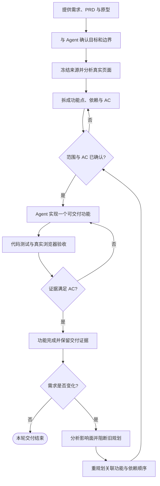
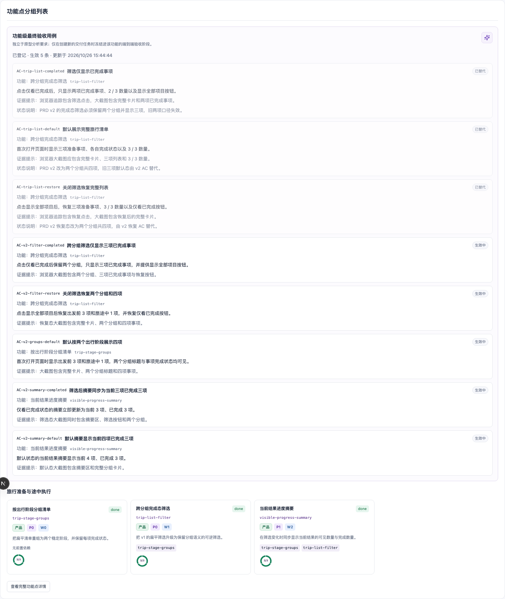

# 旅行清单：一个项目从简单需求演进到复杂交付

这是 `mf-dev-flow` 的完整公开示例。它只使用一个合成项目：先冻结 PRD 与原型，拆出并交付一个简单筛选功能；随后摄取 PRD v2，主动识别旧功能受影响，再重规划为三个有依赖关系的功能并全部交付。

所有里程碑中的 `.mf-dev-flow` 都是在中性临时工作区实际执行本仓库 CLI 后冻结的状态，不是为了截图手工拼装的数据。生成方法、命令哈希与验证方式见 [`generation/README.md`](generation/README.md)。

## 先看懂：一个功能如何进入开发

日常使用时，不需要先记住一长串 CLI。你先用自然语言告诉 Agent 目标、输入和边界；Agent 负责选择流程、调用 `mf-dev-flow`、修改业务代码并组织验证。需要你决定的需求、范围和验收标准仍由你确认。



这张图刻意把“确认”放在“开发”之前，把“影响分析”放在“直接改代码”之前。`mf-dev-flow` 的价值不是替 Agent 写代码，而是让 Agent 的判断、代码改动、测试和验收处在同一条可追溯链路上。

## 推荐使用方式：和 Agent 对话推进

下面五句话就是这个示例的用户操作主线。每轮先让 Agent 汇报结论和待确认项，再决定是否继续。

| 阶段 | 你可以对 Agent 说 | 你应该收到的结果 |
| --- | --- | --- |
| 建立基线 | “我有一份需求文档和原型，请先帮我整理清楚，暂时不要开发。” | 来源版本、当前未分析状态和下一步建议 |
| 分析规划 | “请分析这个原型，整理出第一版需要开发的功能，我确认后再开发。” | 一个用户结果、功能边界和可验证 AC |
| 开发交付 | “开始开发第一个功能，完成后告诉我改了什么，并给我看最终页面。” | 业务代码、自动化测试、截图和交付结论 |
| 需求变化 | “先检查修改后的原型；确认后再分析它会影响哪些已完成功能。” | 新原型检查结果、被影响功能、过期 AC 和复评原因 |
| 重规划 | “按照新需求重新安排功能和开发顺序，确认后逐个完成。” | 三个关联功能、依赖关系和最终验收证据 |

每个 Case 都会继续说明两层内容：前半部分是你如何与 Agent 协作；后半部分是 Agent、`mf-dev-flow` CLI、业务代码、测试/浏览器和看板实际上如何分工。文末的命令用于审计和复现，不是要求用户手工代替 Agent 执行整个工作流。

## 五分钟最小闭环

如果只想判断它是否有用，可以直接观察已经完成 Case 03 的冻结状态：

```bash
npm --prefix ../../modules/prototype ci
pnpm --dir ../../dashboard install
node scripts/select-case.mjs case-03
node ../../scripts/mf-dev-flow.mjs dashboard
```

打开 <http://127.0.0.1:4173/>，查看“功能点分组列表”和“运行历史”，再打开 `app/index.html` 点击筛选按钮。你会看到同一功能的需求、三条 AC、三阶段交付、浏览器证据和 `done` 结论在同一条链路上。


## 完整演进索引

| Case | 你与 Agent 的目标 | 项目状态 | 核心价值 |
| --- | --- | --- | --- |
| [01 · PRD 与原型基线](cases/01-prd-and-prototype-baseline.md) | 只冻结输入，不开发 | 来源已冻结，尚未分析 | 不把“收到文档”伪装成“已理解” |
| [02 · 原型分析与功能拆解](cases/02-prototype-analysis-and-planning.md) | 先给功能与 AC，再确认 | 原型 ready，功能 not_started | 用真实状态证据拆出用户结果和 AC |
| [03 · 交付第一个功能](cases/03-first-delivery.md) | 按 AC 实现并提交证据 | v1 功能 done | 方案、开发、浏览器验收和总控验证闭环 |
| [04 · PRD 变化与影响分析](cases/04-prd-change-impact.md) | 先确认修改后的原型，再分析影响 | 旧功能 review_required | 从原型变化追溯到旧功能和旧 AC，主动阻止沿用过期规划 |
| [05 · 重规划与最终交付](cases/05-replan-and-final-delivery.md) | 重排依赖并逐项交付 | 3 个功能全部 done | 拆分依赖、替代旧 AC、逐功能重新交付 |

## 最终效果




## 切换任意里程碑

以下命令只用于阅读已经冻结的示例状态，不会重新执行开发：

```bash
node scripts/select-case.mjs case-01
node scripts/select-case.mjs case-02
node scripts/select-case.mjs case-03
node scripts/select-case.mjs case-04
node scripts/select-case.mjs case-05
```

`select-case.mjs` 会先核对快照清单和 SHA-256，再替换当前示例的 `.mf-dev-flow`。看板只读这些状态；不会修改业务结论。

## 验证真实生成数据

```bash
node scripts/verify-example.mjs case-01 case-02 case-03 case-04 case-05
node --test scripts/*.test.mjs
node --test app/filter-state.test.mjs
```

验证器会把每个里程碑复制到新的临时路径，核对完整文件清单、最终 gate、相对命令参数，并重新读取 PRD、原型、功能地图、AC 与影响状态。

## 数据与隐私边界

- PRD、原型、应用内容和名称全部为公开合成数据。
- `generation/*.jsonl` 只保留相对参数、退出码和输出哈希，不保存原始输出或本机绝对路径。
- 截图来自本示例的真实浏览器运行，并保留完整卡片所在区块。
- 示例快照可以公开；真实业务项目的 `.mf-dev-flow`、原型、截图和运行日志仍应按团队策略保留在本地。
