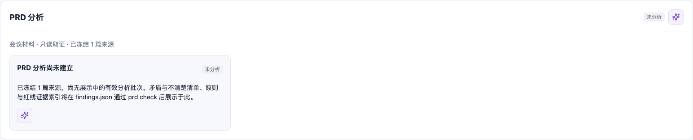

# Case 01：从 PRD 与原型基线开始

难度：入门 · 预计 3–5 分钟

## 场景说明

团队只有一份 PRD v1 和一个可交互 HTML 原型，还没有功能地图，更没有“已完成”的开发结论。本 Case 的目标不是立刻写代码，而是先登记项目、冻结 PRD 来源和原型位置，让后续分析始终知道自己依据的是哪一版输入。

## 你可以这样对 Agent 说

> 我有一份需求文档和原型，请先帮我整理清楚，暂时不要开发。告诉我已经确认了什么，还缺什么。

用户不需要先了解流程命令或状态字段。Agent 会把这句自然语言转换为“登记输入、冻结来源、暂不开发”的工作边界，并明确区分已经收到的材料和仍待分析的内容。

## Agent 会如何推进

1. 检查当前目录是不是正确项目，并确认允许写入 `.mf-dev-flow/`。
2. 选择 PRD 与原型流程，登记项目名称和输入来源。
3. 冻结 `prd/v1.md` 与原型入口，读取状态确认它们仍处于待分析阶段。
4. 停在基线结果，向你汇报“已登记”和“未分析”的边界，不进入功能开发。

## 你需要确认什么

- PRD 指向正确版本，而不是一份后来修改过的文件。
- 原型入口能被后续浏览器分析使用。
- 功能地图尚不存在，业务代码也没有变化。
- Agent 明确说明下一步需要分析，而不是声称任务已经完成。

## 输入原型预览

这是本阶段收到的旅行清单 v1 原型。它只表示“原型输入已经提供”，不表示页面已经完成分析、功能拆解或开发验收。


## 页面证据



## 效果说明

- 建立“输入是什么”的可追溯基线。
- 明确区分“已收到文档”和“已经理解并验收文档”。
- 后续原型、功能和交付都能追溯到这份冻结来源。

## 幕后实现：Agent 与代码如何分工

| 参与者 | 本阶段职责 | 产生的结果 |
| --- | --- | --- |
| 你 | 提供 PRD、原型和“暂不开发”的边界 | 明确的输入与授权范围 |
| Agent | 识别应进入 PRD/原型流程，调用 CLI，并解释状态 | 基线结论与下一步建议 |
| `mf-dev-flow` | 执行 `init`、`prd ingest`、`prototype init`，写入受控状态 | `.mf-dev-flow` 中的项目、PRD 和原型记录 |
| 业务代码 | 本阶段不参与 | `app/` 保持不变 |
| 看板 | 只读展示冻结来源和待分析状态 | 可核查页面，不产生业务结论 |

## 高级复现：查看实际状态和命令

下面的命令只是切换到已冻结的 Case 01 并启动看板，不会重新分析或开发：

```bash
node scripts/select-case.mjs case-01
node ../../scripts/mf-dev-flow.mjs dashboard
```

真实生成时的核心命令链是：

```text
init
→ prd ingest
→ prototype init
→ project status
→ prd status
→ prototype status
```

完整参数、退出码和输出哈希见 [`../generation/case-01.jsonl`](../generation/case-01.jsonl)。

下一步：进入 Case 02，让 Agent 用真实浏览器证据完成原型分析，再把观察结果收敛为第一个可交付功能。
