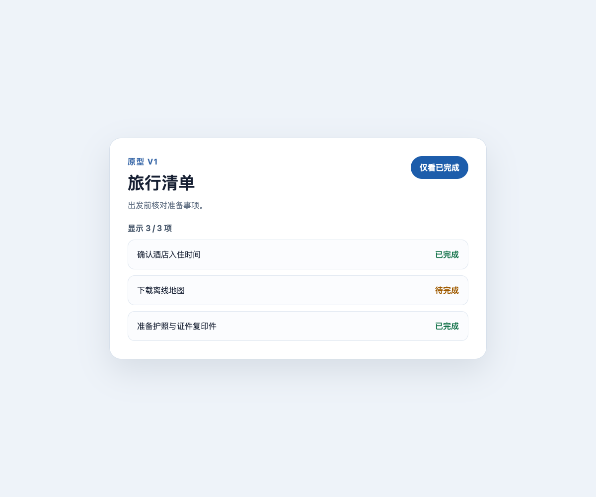
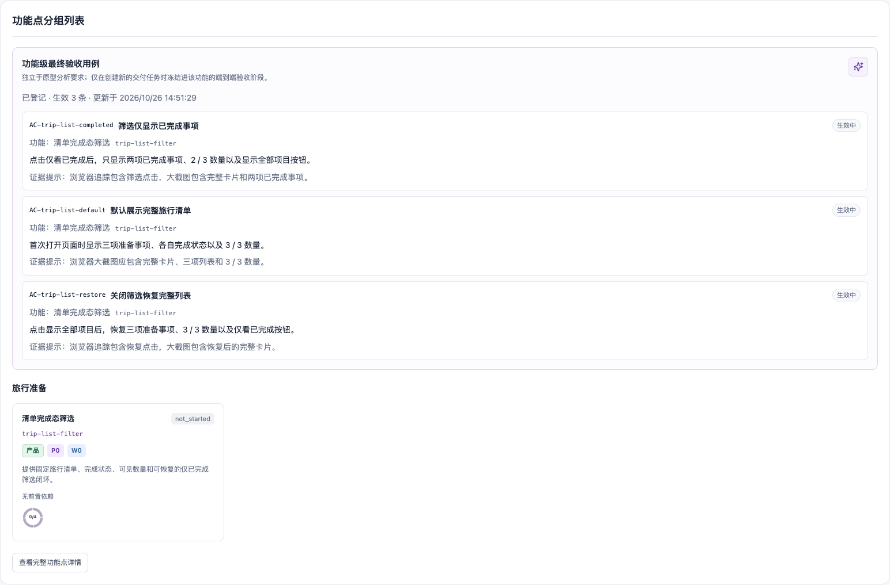

# Case 02：分析原型并拆出第一个功能

难度：入门进阶 · 预计 5–8 分钟

## 场景说明

PRD v1 要求旅行清单支持“仅看已完成”。现在需要把已冻结的文档和原型转成可开发范围。Agent 必须先在真实浏览器中观察默认、筛选和恢复三个状态，再把它们收敛为一个用户结果，而不是按页面状态拆成三个伪功能。

## 你可以这样对 Agent 说

> 请分析这个原型，整理出第一版需要开发的功能。先给我看功能拆分和完成标准，我确认后再开发。

用户只需要说明希望先看分析结果。具体要观察哪些页面状态、怎样形成验收标准，以及如何登记证据，由 Agent 按流程完成；在用户确认前不会进入开发。

## Agent 会如何推进

1. 从 PRD 中提取与筛选有关的原文和可验证约束。
2. 在浏览器里依次操作默认、筛选和恢复状态，登记截图与 trace。
3. 审计原型证据，确认观察结果足以支撑功能拆解。
4. 将三个页面状态收敛为一个叶子功能 `trip-list-filter`。
5. 生成三条最终 AC 和功能分组 proposal，等待确认后应用到功能地图。
6. 汇报功能仍为 `not_started`，明确本阶段没有修改 `app/`。

## 你需要确认什么

- 三个截图来自同一个真实原型，而不是文字推测。
- 功能按用户结果拆分，不是把三个按钮状态拆成三个任务。
- AC 分别覆盖默认、筛选和恢复，并且都可以由浏览器行为验证。
- 功能状态保持 `not_started`，没有提前声称已实现。

## 原型证据

默认状态：


仅看已完成：


恢复全部：



## `mf-dev-flow` 看板结果

看板把三条生效中的最终验收用例和“清单完成态筛选”功能卡放在同一区块。此时功能仍是 `not_started`，说明范围与完成标准已经形成，但开发尚未开始。



## 效果说明

- 原型状态由 `stale` 变为 `ready`。
- 三个页面状态被拆为一个叶子功能 `trip-list-filter`，而不是三个按钮级任务。
- 功能状态是 `not_started`；三条 AC 已冻结，但没有提前声称实现完成。
- 功能地图、原型入口和 observed 截图形成可追溯关系。

## 幕后实现：Agent 与代码如何分工

| 参与者 | 本阶段职责 | 产生的结果 |
| --- | --- | --- |
| 你 | 说明希望得到的用户结果，并确认功能边界与 AC | 可进入开发的确认范围 |
| Agent | 阅读 PRD、操作浏览器、归纳页面状态、编写 proposal | 原型结论、功能定义和 AC |
| `mf-dev-flow` | 核验引文，登记 evidence，执行 audit/accept/refine/apply | 可追溯的原型批次和功能地图 |
| 业务代码 | 本阶段不参与 | `app/` 仍不变 |
| 浏览器与看板 | 浏览器提供观察证据；看板展示功能和 AC | “看到什么”与“计划什么”分开保存 |

## 高级复现：查看实际状态和命令

```bash
node scripts/select-case.mjs case-02
node ../../scripts/mf-dev-flow.mjs dashboard
```

真实生成时的技术链路是：

```text
prd check / prd render
→ prototype evidence / prototype audit / prototype accept
→ feature refine
→ feature proposal-patch
→ feature apply
→ feature acceptance add
```

完整参数、失败门禁、退出码和输出哈希见 [`../generation/case-02.jsonl`](../generation/case-02.jsonl)。

下一步：Case 03 让 Agent 按已经确认的 AC 真正实现这个功能，并把每条 AC 绑定到测试和浏览器证据。
