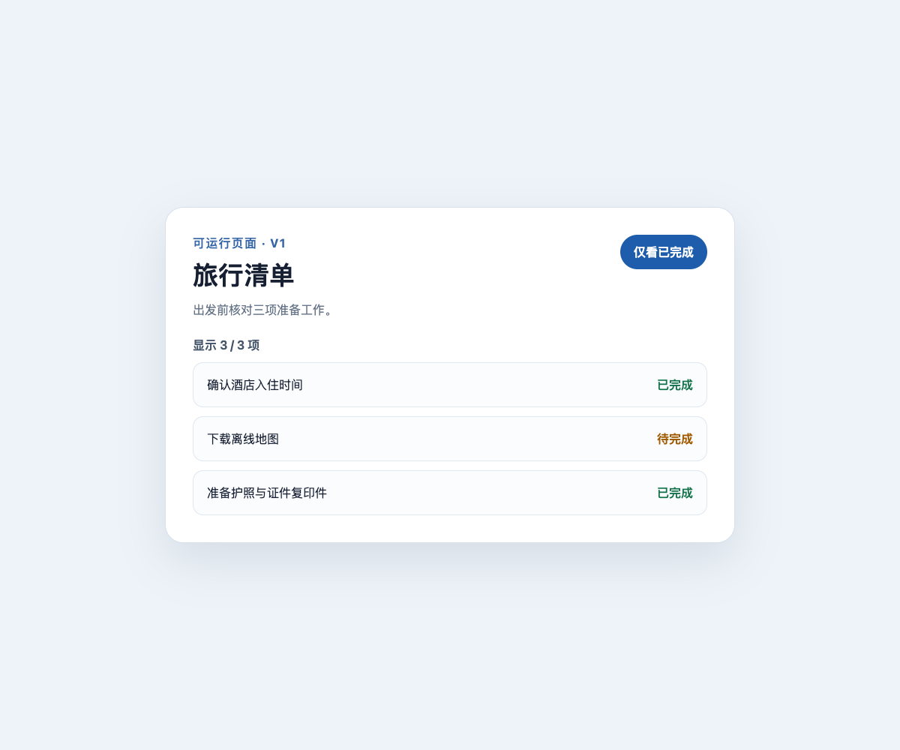
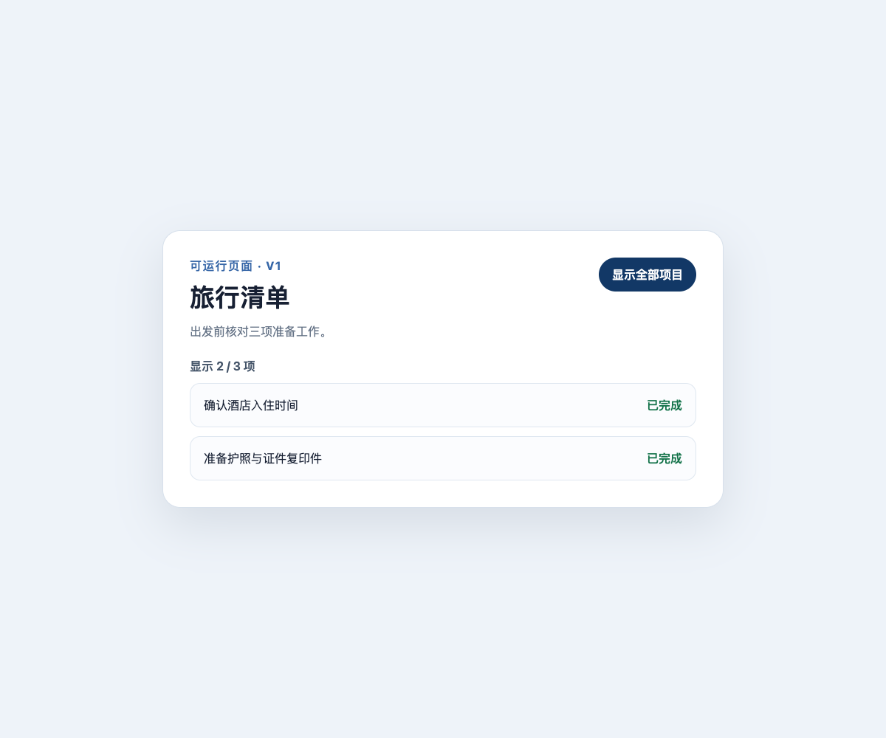
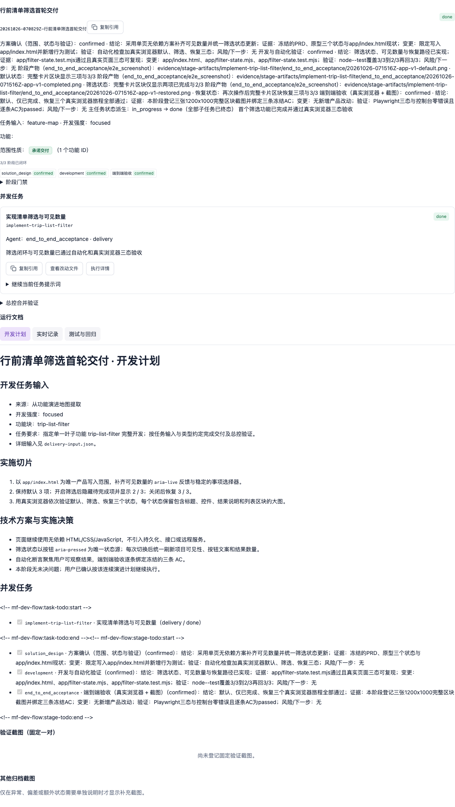

# Case 03：交付第一个功能

难度：入门进阶 · 预计 8–12 分钟

## 场景说明

PRD、原型分析、功能点和三条最终验收用例已经冻结，但功能仍是 `not_started`。这一阶段才真正开发“清单完成态筛选”，让默认、仅已完成和恢复三个状态都拥有自动化与浏览器证据。

本 Case 使用 `web-product@1` 连续交付流程。完成不是 Agent 口头说“代码写好了”，而是方案、代码、测试、真实浏览器验收和总控验证全部闭环后，功能才投影为 `done`。

## 你可以这样对 Agent 说

> 请按已经确认的 `trip-list-filter` 功能和三条 AC 开始开发。写入范围只允许在 `app/`。先说明实现方案，再修改代码；完成后运行单元测试，在真实浏览器里验证默认、筛选、恢复三个状态，并把每条 AC 对应的证据和最终结论告诉我。

这段话给 Agent 四个明确约束：使用已确认范围、限制写入目录、先方案后代码、必须用真实证据收尾。

## Agent 会如何推进

1. 读取功能、AC、依赖和当前状态，确认它确实可以进入开发。
2. 启动 `web-product@1` 交付运行，声明任务、叶子功能和 `app/` 写入范围。
3. 给出实现计划，把筛选状态计算从页面渲染中拆成可测试模块。
4. 修改 `app/filter-state.mjs`、页面行为和对应测试。
5. 运行自动化测试，再用浏览器操作默认、筛选和恢复三个状态。
6. 将截图逐条绑定到对应 AC，完成阶段结论、合并检查和总控验证。
7. 只有全部门禁通过后，才把运行和功能状态更新为 `done`。

## 你需要确认什么

- Agent 只修改了授权的 `app/` 范围。
- 默认三项、筛选两项、恢复三项与冻结 AC 一一对应。
- 自动化测试和浏览器截图都来自本次实现，不是沿用原型证据。
- 看板显示方案、开发、端到端验收三个阶段均完成。
- 功能变成 `done` 发生在总控验证之后。

## 应用效果

默认状态：



仅看已完成：



恢复全部：


## 看板变化

功能分组区块同时显示三条 AC、所属“旅行准备”分组、完整功能卡和 `3/3` 阶段闭环：


交付运行区块保留三阶段结论、任务状态、写入范围、开发计划与验证记录：



## 效果说明

- 功能状态由 `not_started` 变为 `done`。
- 状态计算被拆为可测试模块，单元测试覆盖 `3/3 → 2/3 → 3/3` 可逆闭环。
- 三张 1200 × 1000 截图均来自真实浏览器，包含标题、按钮、数量反馈和整个列表卡片，而不是孤立控件截图。
- 三条冻结 AC 分别绑定对应截图；总控验证通过后才允许运行完成。
- 里程碑含 68 个经哈希清单核对的 `.mf-dev-flow` 文件。

## 幕后实现：Agent 与代码如何分工

| 参与者 | 本阶段职责 | 产生的结果 |
| --- | --- | --- |
| 你 | 确认 AC、写入范围和开始开发的授权 | 可执行的交付边界 |
| Agent | 制定方案、编辑代码、运行测试、操作浏览器、解释结果 | 完成的实现与验收报告 |
| `mf-dev-flow` | 创建交付运行，登记计划、阶段证据、AC 结论和总控状态 | 可续做、可审计的交付链路 |
| 业务代码 | `filter-state.mjs` 计算筛选视图，`index.html` 负责渲染和交互 | 用户真正使用的筛选功能 |
| 自动化测试 | 验证状态计算和可逆切换 | 可重复执行的代码级证据 |
| 浏览器 | 验证完整页面中的真实交互和视觉结果 | 三张对应 AC 的端到端截图 |
| 看板 | 只读聚合功能、AC、阶段和证据 | 人可以快速核查的最终状态 |

## 高级复现：查看冻结结果

```bash
node scripts/select-case.mjs case-03
node ../../scripts/mf-dev-flow.mjs dashboard
node --test app/filter-state.test.mjs
```

真实生成时，Agent 调用的核心 CLI 链路是：

```text
feature start
→ work plan / work claim / work bind-session
→ delivery stage / delivery stage-artifact
→ delivery acceptance
→ work finish / work merge-check / work verify
→ run set --status done
```

其中一个真实证据登记命令是：

```bash
node ../../scripts/mf-dev-flow.mjs delivery stage-artifact \
  --run 20261026-070829Z-行前清单筛选首轮交付 \
  --task implement-trip-list-filter \
  --stage end_to_end_acceptance \
  --kind e2e_screenshot \
  --file screenshots/case-03/app-v1-default.png \
  --caption "默认状态：完整卡片区块显示三项与 3 / 3"
```

完整、去本机路径的命令记录见 [`../generation/case-03.jsonl`](../generation/case-03.jsonl)。

## 下一步为什么发生

首个功能完成后，产品提出“按出行阶段分组”和“显示当前筛选结果进度”。这不是简单新增两块 UI：它会改变现有筛选的数据结构和统计口径。Case 04 将让 Agent 先分析 PRD v2 与原型 v2 的影响范围，而不是直接覆盖已经完成的代码和证据。
