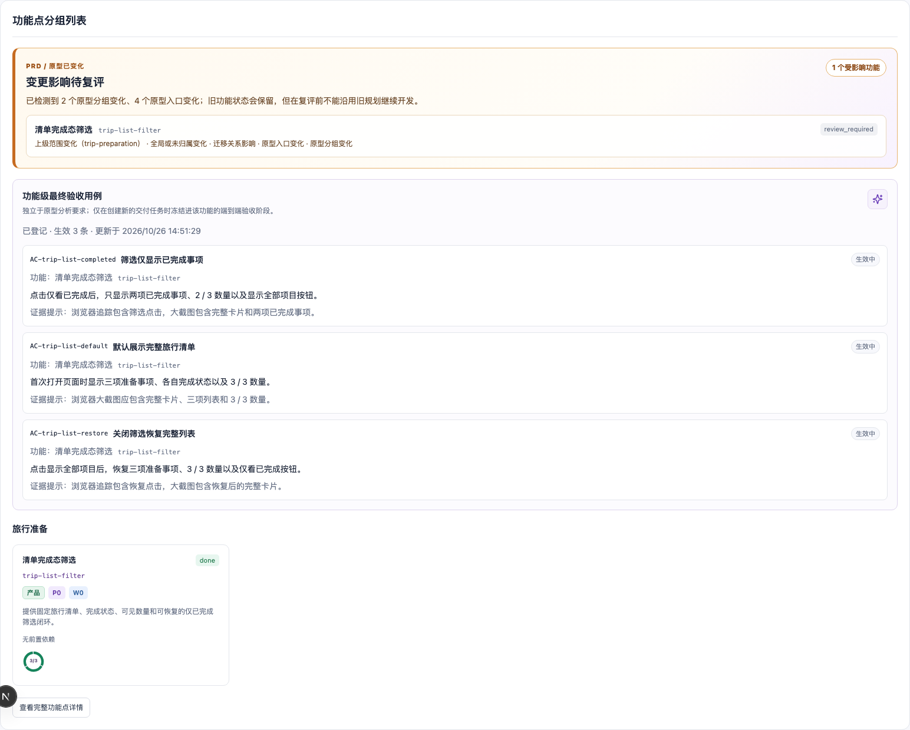

# Case 04：PRD 调整后主动分析影响面

难度：进阶 · 预计 6–10 分钟

## 场景说明

v1 筛选已经交付完成，产品随后提出 PRD v2：清单要按“出发前 / 旅途中”分组，并显示当前筛选结果的进度摘要。这个变化会同时影响旧数据结构、筛选口径和验收标准，不能直接在 `done` 功能上继续堆代码。

## 你可以这样对 Agent 说

> PRD 和原型已经更新到 v2，新增阶段分组和当前结果摘要。请先冻结新输入并分析它对已完成 `trip-list-filter` 的影响。保留 v1 证据，告诉我哪些 AC 可能过期、哪些功能需要复评；在我确认新范围之前不要修改 `app/`。

“先分析，不改代码”是本 Case 的关键。Agent 必须把变化转成影响结论，而不是把新需求悄悄混进已经完成的旧功能。

## Agent 会如何推进

1. 摄取 `prd/v2.md`，保留 v1 来源和历史 findings。
2. 在浏览器中登记 v2 默认、筛选和恢复状态，验收新的原型批次。
3. 对比 PRD、原型入口、业务块和现有功能地图。
4. 执行影响分析，识别旧功能、旧 AC 和数据结构受到的影响。
5. 将规划状态设为 `review_required`，阻止旧范围继续开发。
6. 向你汇报变化、影响原因和建议的重规划方向，不修改业务代码。

## 你需要确认什么

- v1 的交付记录和截图仍然存在，没有被 v2 覆盖。
- 新原型确实增加了两个分组和进度摘要。
- 旧 `trip-list-filter` 被明确标记为待复评。
- 旧功能可以保留历史 `done`，但旧规划不能直接继续使用。
- `app/` 在影响分析阶段没有被 Agent 修改。

## 变化后的原型


## 看板影响区块



## 效果说明

- 系统识别 2 个原型分组、4 个入口变化和 1 个受影响旧功能。
- 旧交付证据没有被删除，也没有被错误套用到 v2。
- 看板同时展示变化告警、旧 AC、受影响功能卡及“待复评”原因。
- 在复评完成前，旧规划不能继续进入开发。

## 幕后实现：Agent 与代码如何分工

| 参与者 | 本阶段职责 | 产生的结果 |
| --- | --- | --- |
| 你 | 提供 PRD/原型 v2，并限制“先分析、暂不开发” | 清晰的变更输入和授权边界 |
| Agent | 对比新旧事实、解释影响、提出复评方向 | 影响报告和待确认问题 |
| `mf-dev-flow` | 冻结 v2 来源，登记新原型批次，执行 `feature impact` | `review_required` 状态与影响原因 |
| 业务代码 | 本阶段不修改 | v1 实现保持原样 |
| 浏览器 | 证明 v2 原型实际出现的新状态 | 新原型证据 |
| 看板 | 同屏展示旧 AC、变化和受影响功能 | 不覆盖历史的影响视图 |

## 高级复现：查看实际状态和命令

```bash
node scripts/select-case.mjs case-04
node ../../scripts/mf-dev-flow.mjs dashboard
```

真实生成时的技术链路是：

```text
prd ingest / prd check / prd render
→ prototype init / prototype evidence / prototype audit / prototype accept
→ feature impact --json
→ planning status = review_required
```

完整参数、退出码和输出哈希见 [`../generation/case-04.jsonl`](../generation/case-04.jsonl)。

下一步：Case 05 会让 Agent 根据影响结论拆出三个有依赖顺序的新范围，并逐个重新交付。
