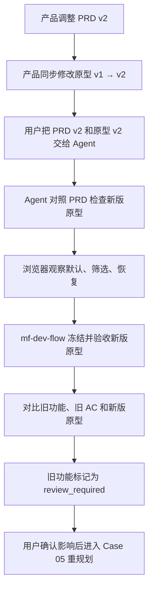
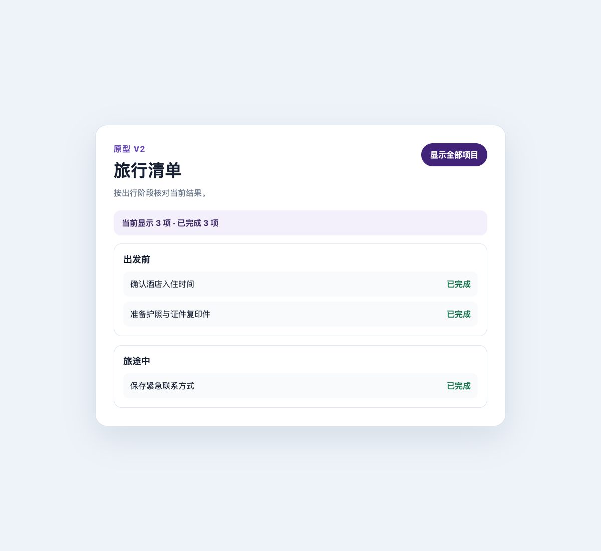

# Case 04：PRD 调整后主动分析影响面

难度：进阶 · 预计 6–10 分钟

## 场景说明

Case 03 已经交付了 v1 筛选。随后产品修改 PRD，并根据新需求把原型从 v1 调整为 v2：清单要按“出发前 / 旅途中”分组，增加一项旅途中事项，并显示当前筛选结果的进度摘要。

这里要分清责任：产品或设计者负责提供修改后的 PRD v2 和原型 v2；Agent 不替产品决定需求，而是先检查新版原型是否真实表达了 PRD，再分析它会影响哪些已完成功能。整个 Case 都不修改正式业务代码 `app/`。

## 产品如何把原型从 v1 改成 v2

先以 [`prototype/v1.html`](../prototype/v1.html) 为基线，再创建 [`prototype/v2.html`](../prototype/v2.html)，完成四处可见调整：

1. 把原来的单一平铺列表改为“出发前”和“旅途中”两个分组。
2. 在“旅途中”增加“保存紧急联系方式”，总数由 3 项变为 4 项。
3. 把“显示 3 / 3 项”改为“当前显示 4 项 · 已完成 3 项”的进度摘要。
4. 调整筛选交互，让筛选与恢复同时更新事项、分组可见性和进度摘要。

| 对比项 | v1 原型 | v2 原型 |
| --- | --- | --- |
| 页面结构 | 单一平铺列表 | “出发前 / 旅途中”两个分组 |
| 事项数量 | 3 项 | 4 项 |
| 状态反馈 | 当前可见数 / 总数 | 当前可见数 / 已完成数 |
| 筛选行为 | 隐藏一项未完成事项 | 跨分组筛选，并同步更新分组和摘要 |

修改前的 v1：


修改后的 v2：


## 从修改原型到影响分析的完整流程



这条流程把两个确认点分开：先确认“新版原型表达正确”，再确认“旧功能受到什么影响”。只有第二个确认完成后，才进入下一阶段的功能重规划。

## 你可以分两轮对 Agent 说

### 第一轮：先检查新版原型

> 需求和原型更新了，请先检查新版原型是否表达了新需求，不要修改正式代码。

Agent 会对照 PRD v2，在浏览器中依次检查默认、仅看已完成和恢复全部三个状态。它应该先告诉你新版原型是否完整体现了两个分组、四项内容和动态进度摘要，而不是立即讨论怎么写业务代码。

### 第二轮：原型确认后再分析影响

> 新版原型确认没问题。请分析它会影响哪些已完成功能和验收标准，暂时不要开发。

Agent 会把新版原型与 Case 03 已完成的功能、三条旧 AC 和历史证据进行对比，输出受影响范围及重规划建议。

## Agent 会如何推进

1. 摄取 `prd/v2.md`，保留 PRD v1 和 Case 03 的历史交付记录。
2. 用 `prototype/v2-init.json` 建立新的原型分析批次，不覆盖 v1 原型证据。
3. 在真实浏览器中登记 v2 默认、筛选和恢复三个状态。
4. 审计证据；只有页面状态和 PRD 对得上，才接受这批 v2 原型分析。
5. 对比新 PRD、新原型、现有功能地图和旧 AC，执行功能影响分析。
6. 将旧 `trip-list-filter` 的规划状态设为 `review_required`，阻止沿用旧范围继续开发。
7. 向你汇报原型变化、受影响原因和重规划建议；`app/` 保持 Case 03 的实现不变。

## Agent 在浏览器中观察什么

默认状态必须出现两个分组、四项内容和“当前显示 4 项 · 已完成 3 项”：


开启筛选后，两个分组仍然存在，只显示三项已完成内容，摘要同步为 3 / 3：



关闭筛选后，四项内容、两个分组和默认摘要全部恢复：


## 原型变化如何变成影响结论

| 观察到的变化 | 对 Case 03 旧功能的影响 | Agent 的结论 |
| --- | --- | --- |
| 平铺列表变成两个分组 | 旧筛选只理解单一列表 | 数据结构和渲染范围需要复评 |
| 默认内容从 3 项变为 4 项 | “默认三项”的旧 AC 不再适用 | 旧 AC 不能直接沿用 |
| 筛选后仍保留两个分组 | 旧筛选没有分组可见性规则 | 筛选功能需要升级，而不是只加样式 |
| 新增当前结果摘要 | 旧页面只计算可见数 | 需要独立的摘要能力和新 AC |

因此，历史交付仍然是 `done`，但旧规划已经不能指导下一轮开发；`mf-dev-flow` 将它标记为 `review_required`，等待 Case 05 重规划。

## 你需要确认什么

- v1 的交付记录和截图仍然存在，没有被 v2 覆盖。
- 新原型确实增加了两个分组和进度摘要。
- 旧 `trip-list-filter` 被明确标记为待复评。
- 旧功能可以保留历史 `done`，但旧规划不能直接继续使用。
- `app/` 在影响分析阶段没有被 Agent 修改。

## 看板影响区块


## 效果说明

- 系统识别 2 个原型分组、4 个入口变化和 1 个受影响旧功能。
- 旧交付证据没有被删除，也没有被错误套用到 v2。
- 看板同时展示变化告警、旧 AC、受影响功能卡及“待复评”原因。
- 在复评完成前，旧规划不能继续进入开发。

## 幕后实现：Agent 与代码如何分工

| 参与者 | 本阶段职责 | 产生的结果 |
| --- | --- | --- |
| 你 / 产品 | 修改并提供 PRD v2 与原型 v2，先确认原型，再授权影响分析 | 清晰的变更输入和两个确认点 |
| Agent | 操作浏览器检查新版原型，再对比旧功能和 AC | 原型检查结论、影响报告和待确认问题 |
| `mf-dev-flow` | 冻结 v2 来源，登记新原型批次，执行 `feature impact` | `review_required` 状态与影响原因 |
| 业务代码 | 本阶段不修改 | v1 实现保持原样 |
| 浏览器 | 证明 v2 默认、筛选和恢复三个状态真实存在 | 新原型证据 |
| 看板 | 同屏展示旧 AC、变化和受影响功能 | 不覆盖历史的影响视图 |

## 高级复现：查看实际状态和命令

```bash
node scripts/select-case.mjs case-04
node ../../scripts/mf-dev-flow.mjs dashboard
```

真实生成时的技术链路也分为两轮：

```text
第一轮：prd ingest / prd check / prd render
     → prototype init / prototype evidence / prototype audit / prototype accept

第二轮：feature impact --json
     → planning status = review_required
```

完整参数、退出码和输出哈希见 [`../generation/case-04.jsonl`](../generation/case-04.jsonl)。

下一步：Case 05 会让 Agent 根据影响结论拆出三个有依赖顺序的新范围，并逐个重新交付。
