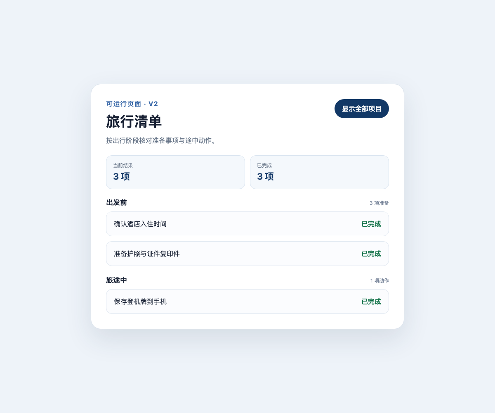
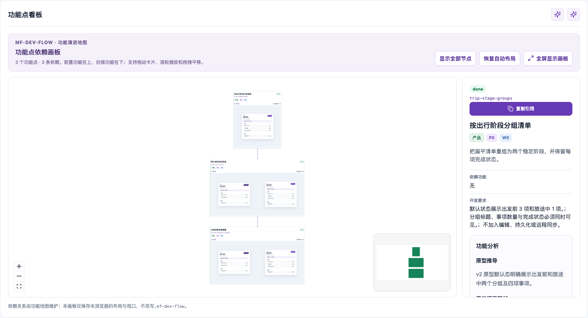

# Case 05：重规划并完成复杂版本

难度：完整闭环 · 预计 12–20 分钟

## 场景说明

影响分析确认 v2 不是一次局部样式修改。旧 `trip-list-filter` 需要被结构性拆分为三个可独立验收、又存在依赖顺序的功能：

1. `trip-stage-groups`：建立两个阶段和四项清单。
2. `trip-list-filter`：升级为保留分组语义的可逆筛选。
3. `visible-progress-summary`：基于当前筛选结果显示可见数和完成数。

依赖顺序是“分组 → 筛选 → 摘要”。三个功能分别走 `web-product@1` 的方案、开发、端到端验收和总控验证。

## 你可以这样对 Agent 说

> 根据 Case 04 的影响分析重新规划 v2。请把阶段分组、跨分组筛选和当前结果摘要拆成独立功能，说明依赖顺序、旧 AC 如何处理以及每个功能的新 AC。先给我确认 proposal；确认后再按依赖顺序逐个开发，每完成一个功能都要提交代码测试、浏览器证据和交付结论。

这段对话把“重规划”和“连续开发”分成两个确认点：先确认新的功能地图，再授权 Agent 按依赖顺序实施。

## Agent 会如何推进

1. 基于影响报告重新执行功能 refine，形成三个叶子功能和依赖关系。
2. 修订旧 AC 为 `superseded`，新增五条 v2 AC，并写入逐项影响复评。
3. 尝试应用 proposal；如果迁移信息不完整，保留门禁失败并补齐后重试。
4. 先交付 `trip-stage-groups`，让数据和页面具备两个阶段。
5. 再升级 `trip-list-filter`，保证筛选后仍保留分组语义。
6. 最后交付 `visible-progress-summary`，让摘要读取当前可见结果。
7. 每个功能分别完成方案、代码、测试、浏览器验收和总控验证。
8. 汇报旧事实如何保留、新功能如何依赖以及最终五条 AC 的证据。

## 你需要确认什么

- 三个功能是独立用户结果，而不是按文件或组件机械拆分。
- 依赖顺序为“分组 → 筛选 → 摘要”，后续功能没有绕过前置范围。
- v1 三条 AC 被标记为已替代，而不是删除。
- v2 五条 AC 都能在最终页面和看板中找到证据。
- 第一次 proposal 门禁失败被保留，补齐迁移后才成功发布。
- 三个功能都独立完成交付运行，没有用一个 `done` 覆盖所有范围。

## 最终应用效果

默认态显示两个分组、四项内容和 4/3 摘要：


筛选态保留两个分组，并把摘要同步为 3/3：



## 最终看板效果

旧三条 AC 明确标记“已替代”，五条 v2 AC 生效；三个功能卡全部 `done`、阶段均为 `3/3`：


依赖画板展示三个功能从上到下的演进关系：



## 效果说明

- 功能地图重新回到 `fresh`，三个叶子功能全部 `done`。
- v1 三条 AC 保留历史但标记 `superseded`；v2 五条 AC 全部生效。
- 每个功能都有独立方案、自动化测试、1200 × 1000 浏览器大图和总控验证。
- 最终里程碑包含 161 个经 SHA-256 清单核对的 `.mf-dev-flow` 文件。

## 幕后实现：Agent 与代码如何分工

| 参与者 | 本阶段职责 | 产生的结果 |
| --- | --- | --- |
| 你 | 确认新的功能地图、依赖、AC 和连续开发授权 | 可执行的 v2 交付顺序 |
| Agent | 编写 proposal、处理门禁反馈、按依赖修改代码并逐项验收 | 三次独立交付和最终汇报 |
| `mf-dev-flow` | 保存迁移、影响复评、AC 版本、依赖图和三个交付运行 | 可追溯的复杂需求演进 |
| 业务代码 | `index.html` 渲染分组和摘要；`filter-state.mjs` 计算分组筛选及当前计数 | v2 最终可运行页面 |
| 自动化测试 | 验证分组、筛选、摘要和可逆状态 | 代码级回归证据 |
| 浏览器 | 验证默认和筛选后的完整页面行为 | 最终端到端截图 |
| 看板 | 展示旧 AC、新 AC、三个功能状态及依赖图 | 完整演进结果的可视化索引 |

## 高级复现：查看冻结结果

```bash
node scripts/select-case.mjs case-05
node ../../scripts/mf-dev-flow.mjs dashboard
node --test app/filter-state.test.mjs
```

真实生成时的技术链路是：

```text
feature impact / feature refine
→ feature proposal-patch
→ feature apply（第一次因迁移不完整被拒绝）
→ 补齐 migration 与 impactReviews
→ feature apply
→ 按依赖顺序执行 3 次 feature start
→ 每次完成 work plan / delivery stage / acceptance / work verify
→ 3 次 run set --status done
```

完整参数、门禁失败、三次交付运行和输出哈希见 [`../generation/case-05.jsonl`](../generation/case-05.jsonl)。

这就是示例要表达的完整价值：用户通过对话控制目标、边界和确认点；Agent 负责编排分析与开发；业务代码产生真实功能；`mf-dev-flow` 保存状态与证据。需求变化不会覆盖旧事实，而会触发影响分析、范围重组、依赖排序、重新交付和新的验收证据。
