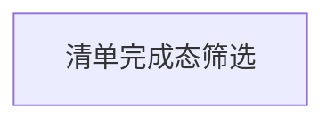

# 功能演进地图

- 来源拆解运行：`20261026-064908Z-功能演进拆解`
- 原型运行：`analysis-1cb1b985c917c0fde5d2a804`
- 证据游标：`7ae4a1970bcb6b37e4cbec24130e1cd9b07c00e6fa95cd637a2e4184cb5cd0e5`
- 更新时间：2026-10-26T06:50:46.940Z

> 本文是原型、代码、开发历史、系统卡片和范围文档的当前执行视图；事实仍以各自真源为准。

## 功能块与执行顺序

> 功能块及其叶子功能按 `rank` 从上到下展示；该顺序就是当前的评估与执行顺序，最上方优先处理。依赖必须指向更靠上的功能。`P1-1` 与 `W2` 是范围/波次标签，不再决定看板排序。信息或方案变动后，应重新运行 `feature refine`，允许重组功能块并调整顺序。

## 任务要求与历史阶段

新任务不预设阶段，按任务创建时冻结的类型、输入和验收要求执行；用 work delivery-brief 读取当前任务要求。地图不自行定义任务阶段。

以下仅解释历史阶段契约；旧任务恢复时继续遵守，新任务不自动继承：
1. **原型对齐（逐区 UI 与交互）**：在实际 UI 项目复刻原型的页面、样式、交互、状态与展示字段。
2. **接口 Mock（契约、字段与可替换响应）**：建立可替换的服务端 Mock 契约，客户端通过适配层消费而不在页面散落造数。
3. **技术实现（方案、真实后端与功能 e2e）**：确认技术边界并完成真实后端、客户端接通和功能级 e2e。
4. **全链路测试（真实 UI 与后端验收）**：在真实 UI 与后端上验收，完成同状态截图逐区审查及长期真源回写。

> 历史任务的 not_applicable 仍需明确依据；中间检查点完成不代表产品任务完成。

## 依赖图

## 10 · 旅行准备

业务域 ID：`trip-preparation`；功能块顺序：10；来源旧功能：`trip-list`。

| 顺序 | ID | 叶子功能 | 类型 | 独立用户结果 | 优先级 | 波次 | 真实实现状态 | 小闭环阶段 | 原型入口 / 系统卡片 | 依赖 | 阻塞 | 开放风险（独立台账，二次运行输入） |
| --- | --- | --- | --- | --- | --- | --- | --- | --- | --- | --- | --- | --- |
| 10.10 | `trip-list-filter` | 清单完成态筛选 | 产品 | 旅行者可以查看三项准备事项，并在全部项目与两项已完成项目之间往返切换。 | P0 | W0 | not_started | 原型对齐：pending；接口 Mock：pending；技术实现：pending；全链路测试：pending | trip-list-default、trip-list-completed | — | — |  |

## 历史迁移

| 类型 | 旧功能 | 当前叶子功能 | 原因 |
| --- | --- | --- | --- |
| split | trip-list | trip-list-filter | 把原型业务分组落为可独立验收的筛选叶子功能；两个页面状态保持为同一用户闭环。 |
